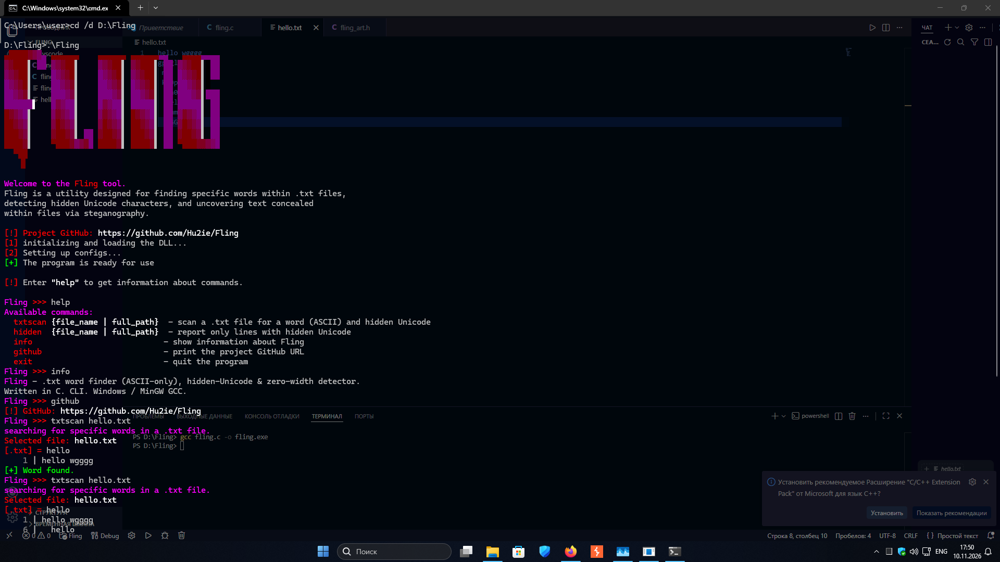

# Fling 🔍

> A lightweight CLI utility for finding specific words in `.txt` files, detecting hidden Unicode characters, and uncovering text concealed via zero-width / bidi steganography.



**Version:** 1.0.0 (Initial Release)  
**Status:** CLI only — Fling GUI is **not** available yet.  
**License:** MIT (Open Source)

---

## 📋 Table of Contents

- [How it works (Architecture)](#-how-it-works-architecture)
- [Features & Commands](#-features--commands)
- [What it detects](#-what-it-detects)
- [Known Limitations](#-known-limitations-version-10)
- [Build & Run](#-build--run-windows--mingw)
- [Example Usage](#-example-usage)
- [License](#-license)

---

## 🛠 How it works (Architecture)

Fling scans the file line-by-line, byte-by-byte. Instead of trying to render the text (which might freeze your terminal due to bidi or tag characters), it uses a custom UTF-8 decoder to inspect every single codepoint.

```text
       [ User Input ]
            │
            ▼
     ┌──────────────┐
     │   Fling CLI  │
     └──────┬───────┘
            │
    ┌───────┴───────┐
    │               │
    ▼               ▼
[ txtscan ]     [ uniscan ]
(ASCII words)   (Hidden Unicode)
    │               │
    └───────┬───────┘
            ▼
     ┌──────────────┐
     │  scan_file() │
     └──────┬───────┘
            │
            ▼
   [ Line Buffer Reader ]
            │
            ├─► Search ASCII word (case-insensitive)
            │
            └─► UTF-8 Decoder (byte-by-byte)
                 │
                 ├─► Valid? ──► Check suspicious list (U+200B, U+202E, etc.)
                 │              ├─► Is Hidden ──► Flag & Annotate ([U+200B])
                 │              └─► Typographic space ──► Dim highlight (Not [BAD])
                 │
                 └─► Invalid / Overlong / Surrogate ──► Flag as [BAD]
```

---

## ✨ Features & Commands

Fling uses a simple REPL (Read-Eval-Print Loop) interface. Once launched, you can use the following commands:

| Command | Description |
|---|---|
| `txtscan <file>` | Scans a `.txt` file for a specific ASCII word (case-insensitive). Also warns if that line contains hidden Unicode. |
| `uniscan <file>` | Dedicated Unicode scanner for `.txt`, `.log`, and `.dat` files. Scans for zero-width spaces, bidi overrides, TAG characters, and invalid UTF-8. Returns `[OK]` or `[BAD]`. |
| `help` | Prints available commands. |
| `info` | Prints tool information. |
| `github` | Prints the repository URL. |
| `exit` / `quit` | Closes the program. |

### What it detects

- **Zero-width characters:** `U+200B` (ZWSP), `U+200C` (ZWNJ), `U+200D` (ZWJ), `U+FEFF` (BOM).
- **Bidi overrides:** `U+202A` – `U+202E`, `U+2066` – `U+2069` (often used for text reversal tricks).
- **TAG characters:** `U+E0000` – `U+E007F` (used in "ASCII smuggling").
- **Invalid UTF-8:** Overlong encodings, surrogate halves, and bytes > `U+10FFFF`.
- **Soft hyphen:** `U+00AD`.

> **Note:** Typographic spaces (`U+2000` – `U+200A`) are highlighted but do **not** trigger a `[BAD]` verdict, as they are commonly used in legitimate typesetting.

---

## 🚧 Known Limitations (Version 1.0)

- **Fling GUI is missing.** Currently, the `[BAD]` verdict recommends launching the GUI to check the strings. This is a placeholder. The GUI is planned for a future release. For now, all analysis is done in the CLI.
- **ASCII-only word search.** The `txtscan` command uses a byte-comparison algorithm. It will explicitly reject non-ASCII words (like Cyrillic or Emoji). `uniscan` works with full UTF-8, but word-matching is limited to ASCII.
- **Binary files.** Running `uniscan` on `.png`, `.exe`, or `.zip` files will likely result in `[BAD]` because binary data naturally contains bytes that are invalid in UTF-8. This is expected behavior, but it might be noisy.
- **False negatives on plain spaces.** A file full of ordinary ASCII spaces (`0x20`) will return `[OK]`. Fling looks for suspicious formatting, not just "invisible stuff".

---

## 🚀 Build & Run (Windows / MinGW)

Fling is written in pure C and requires no external dependencies (only the Windows API and the C standard library).

**Requirements:**

- Windows 11 (or Windows 10)
- GCC (MinGW-w64)

**Build:**

```bash
gcc fling.c -o fling.exe -Wall -Wextra -O2
```

**Run:**

```bash
./fling.exe
```

> **Note:** Make sure `fling_art.h` is in the same directory as `fling.c`.

---

## 💡 Example Usage

```text
Fling >>> uniscan test_hidden.txt
Unicode search in .txt, .log, and .dat files.
Selected file: test_hidden.txt
[~] Searching...
    1 | [U+200B][U+200B][U+200B]...
    2 | [U+200C][U+200C][U+200C]...
[BAD] Suspicious content detected (hidden Unicode, control chars, or invalid UTF-8).
```

---

## 📄 License

This project is licensed under the **MIT License**.

You are free to use, modify, and distribute this software. See the [LICENSE](LICENSE) file for more details.

---

Created by **Hu2ie**.
